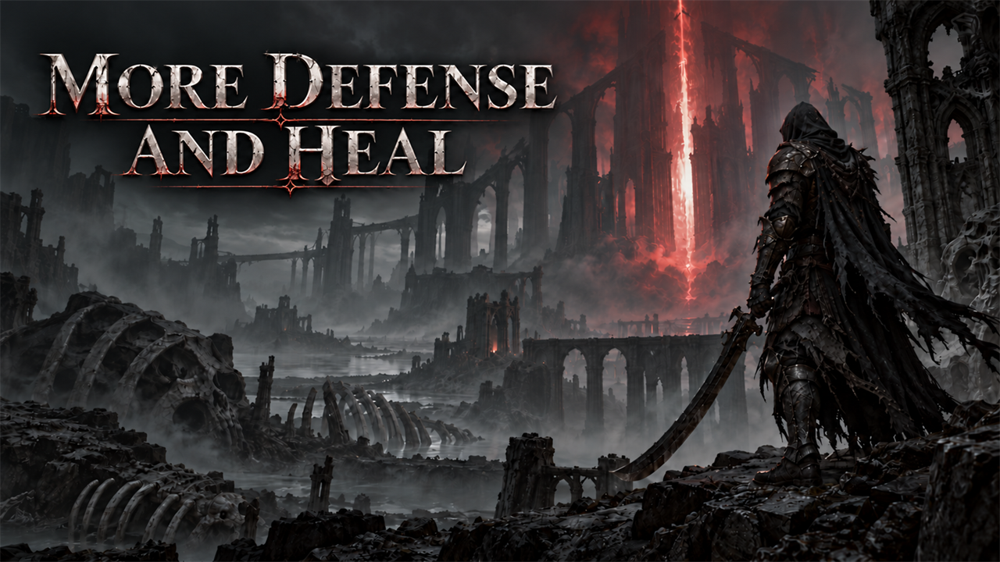

# More Defense and Heal

Each heal charge restores 70 instead of 40 health, and you take about half the damage (base damage reduction 0.5 instead of 0).

## What it does

Your heal charges heal more, and you take less damage.

| | Game | With the mod |
|---|---|---|
| Health per heal charge | 40 | 70 |
| Base damage reduction | 0 | 0.5 (about half the damage taken) |

- One heal charge now restores 70 health: a full heal for the lightest shells (70 health), about half for the
  heaviest (Harros, 150). The healing charge upgrades scale from the new value.
- The damage reduction is the base value. The game's own bonuses still add to it: Harden, shell abilities, upgrades
  and items.
- It changes only the player's start values (and those of the player's decoys). Enemies stay as in the game.

## Screenshots

## How to install

1. Download the zip of the latest release on GitHub (`mortalshell2_moredefandheal_<version>.zip`).
2. Open the game folder `MortalShell2\Content\Paks\`. If it has no folder `~mods`, create it.
3. Unpack the three files of the zip (`mortalshell2_moredefandheal_P.pak`, `.utoc` and `.ucas`) into `MortalShell2\Content\Paks\~mods\`.
4. Start the game.

To update the mod, replace the three files with the ones of the new release. To remove it, delete the three files.

## How to use

Nothing to do: the mod works as soon as you load a game.

## Compatibility

- Game version: 1.12.0 (`1.12.0`).
- The mod replaces one game file: the player's attribute table `DT_PlayerAttributes`. A mod that replaces the same
  file conflicts with this one; only one of them works.
- "Attack Speed Enhanced" replaces the same table. To get both, install "More Defense and Heal + Attack Speed
  Enhanced" instead of the two: it holds the changes of both in one table.
- A game update that changes this table needs a new build of the mod. Until then, the mod puts the older version of
  the table back; remove the mod after a game update until a new version is out.

## Known issues

None yet.

## How to build

Anyone can build this mod from its source code and check that the download matches it.

1. Install the tools: Windows PowerShell 5.1 (part of Windows), [UAssetGUI](https://github.com/atenfyr/UAssetGUI/releases)
   v1.1.0 and [retoc](https://github.com/trumank/retoc/releases) v0.1.5 in a folder `_tools\uassetgui\` and
   `_tools\retoc\` above the repository (or set `UE5_TOOLS`), and the game's mapping file `MortalShell2-1.12.0.usmap` in
   `%LOCALAPPDATA%\UAssetGUI\Mappings\`. `README.md` has the details.
2. Build it: `powershell -ExecutionPolicy Bypass -File .\build.ps1`
3. Find the files: `dist\mortalshell2_moredefandheal_P.pak`, `.utoc` and `.ucas`.

## Credits

Made by Kintaro. MIT license: you may use, change and share this mod. Mortal Shell II and its files belong to
their makers; the mod changes only what is listed above.
